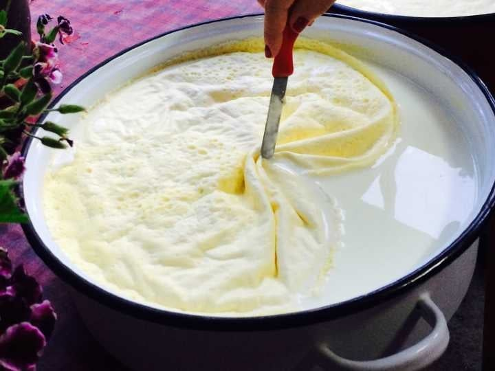
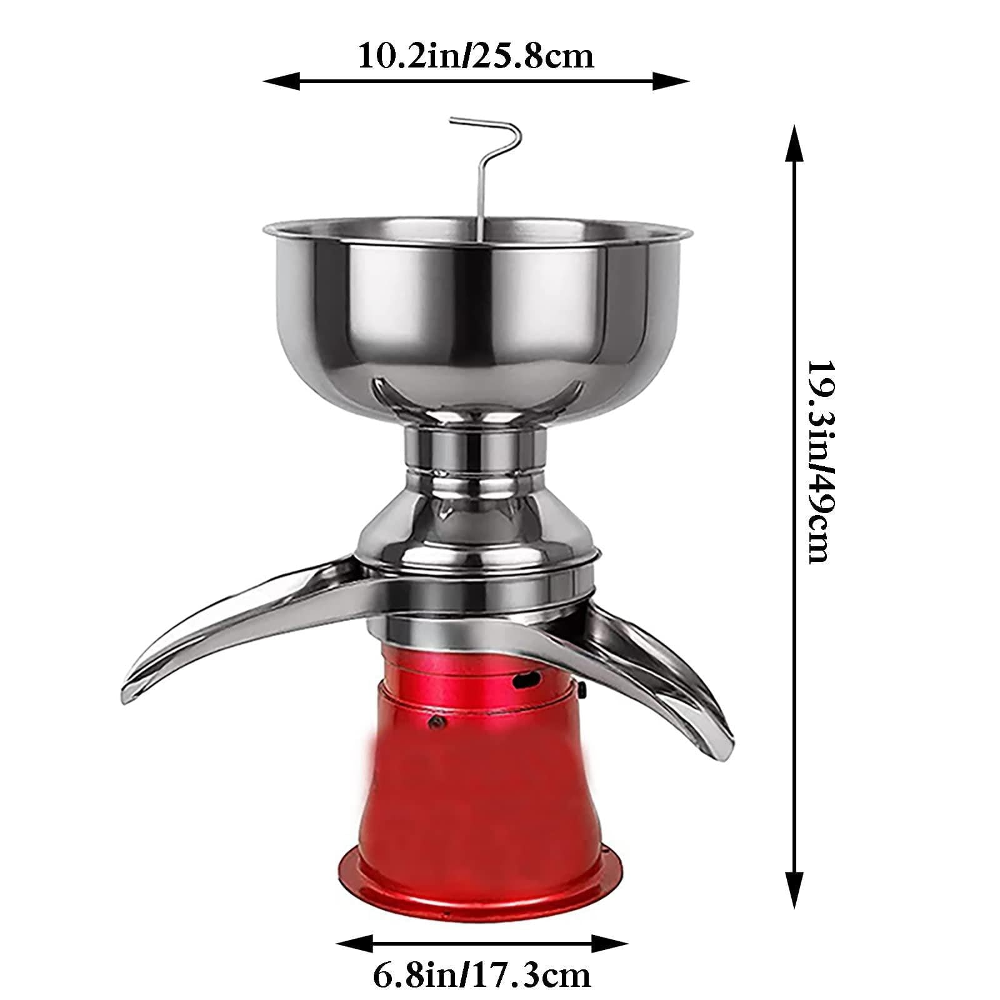

La nata es la parte grasa de la leche. El porcentaje que aparece en su etiqueta indica **cuánta grasa tiene**, no su pureza ni su calidad. Y para la galleta de nata ese número lo cambia todo: en las pruebas del proyecto, las natas del 30 al 40 % no dieron el resultado buscado; el punto llegó con nata de un 70-80 % de materia grasa.

## Qué significa el porcentaje de materia grasa

Es una cuenta por peso. 100 g de nata al 35 % contienen unos 35 g de grasa y 65 g de otras cosas: sobre todo agua, pero también proteínas, lactosa y minerales, y a veces ingredientes añadidos.

| Por cada 100 g de nata | Grasa | Resto (agua, proteínas, lactosa…) |
| --- | ---: | ---: |
| Nata al 18 % | 18 g | 82 g |
| Nata al 35 % | 35 g | 65 g |
| Nata al 50 % | 50 g | 50 g |
| Nata al 70 % | 70 g | 30 g |

Cuando en este portal se habla de una nata del 70 %, se habla de eso: unos 70 g de grasa por cada 100 g de nata. Pesa siempre en gramos: mililitros y gramos no son lo mismo, y menos en una nata espesa.

## Tipos de nata según la norma

En España, la norma de calidad de la nata es la Orden de 12 de julio de 1983. Clasifica las natas según su materia grasa, en porcentaje en masa sobre el producto final:

| Denominación legal | Materia grasa (% en masa) |
| --- | --- |
| Nata delgada o ligera | del 12 % a menos del 30 % |
| Nata | del 30 % a menos del 50 % |
| Doble nata | 50 % o más |

Dos aclaraciones:

- **No existe una categoría legal por encima del 70 %.** Una nata del 70-80 % sigue siendo, legalmente, doble nata. Es un producto muy concentrado que pocas veces se ve en tienda.
- **La referencia internacional es distinta.** La norma del Codex Alimentarius fija un mínimo del 10 % de grasa para llamarse nata. Por eso fuentes de otros países usan otras categorías; en España manda la Orden de 1983.

## Por qué una nata del 35 % no sustituye a una del 70 %

Si en una receta cambias una nata del 70 % por el mismo peso de una del 35 %, metes **la mitad de grasa y más del doble de agua y otros componentes**. Y si pones el doble de nata del 35 % para igualar la grasa, lo que se dispara es el agua.

| Para aportar 70 g de grasa necesitas… | Peso de nata | Lo que entra además de grasa |
| --- | ---: | ---: |
| Nata al 18 % | 389 g | 319 g |
| Nata al 35 % | 200 g | 130 g |
| Nata al 50 % | 140 g | 70 g |
| Nata al 70 % | 100 g | 30 g |

La cuenta es simple: peso necesario = grasa que quieres ÷ porcentaje de grasa. Por ejemplo, 70 ÷ 0,35 = 200 g. Estas tablas son un cálculo, no el análisis de ninguna marca: sirven para entender por qué cambiar de nata obliga a cambiar la receta.

## Lo que queda en la galleta después del horno

Hay tres porcentajes que no conviene mezclar: la grasa de la nata, la cantidad de nata que lleva la masa y la grasa de la galleta ya horneada. Según la experiencia del proyecto, el primero condiciona mucho el último:

| Nata usada | Grasa aproximada en la galleta horneada | Resultado |
| --- | --- | --- |
| 30-40 % de materia grasa | en torno al 20 % | Sabe como una galleta de mantequilla |
| 70-80 % de materia grasa | en torno al 50 % | La galleta de nata de siempre |

Por eso mucha gente acaba haciendo «galletas de nata» con mantequilla buena: la nata tan grasa es muy difícil de conseguir. El resultado puede estar rico, pero es otra galleta. Tienes la explicación en [galletas de nata o de mantequilla](/galletas-de-nata-o-de-mantequilla/).

## La nata de la leche hervida

En casa se llama «nata» a cosas distintas. La capa que aparece al calentar la leche no es grasa pura: un estudio científico sobre esa película describe una estructura de **proteínas de la leche alteradas por el calor y glóbulos de grasa** atrapados en la superficie. Su composición varía, y no se le puede asignar un porcentaje sin medirlo.

Es la nata con la que se hacían las galletas en muchas casas gallegas, y cada casa la recogía y la juntaba a su manera. Lo contamos en [galletas de nata de la abuela](/como-se-hacian-las-galletas-de-nata/).

## Centrifugar o hervir: dos formas de sacar la nata

- **Centrifugado (desnatadora).** Separa la nata de la leche en frío, sin cocerla. Es un desnatado natural y saca más materia grasa. Cuánta, depende del equipo: la documentación técnica de la industria láctea indica que los separadores herméticos pueden superar el 72 % de grasa. Con una desnatadora especial de alta velocidad, el proyecto trabajó con una nata del 70-80 %, según el envase de la lechería.
- **Cocción (método de las abuelas).** Se hierve la leche y se recoge la capa de la superficie. Es la forma tradicional, pero con la cocción se pierde materia grasa y se saca menos nata.

Hervir una nata hasta que espese tampoco la convierte en una nata centrifugada del 70 %: cambia también el resto de su composición.

## Cuál usar para hacer galletas

El proyecto probó primero las natas que se encuentran en la tienda o que venden las lecheras: del 30 %, del 35 % y del 40 % de materia grasa, algunas ya desnatadas de fábrica. Ninguna llegaba al punto buscado. El resultado cambió con una nata de **entre un 70 y un 80 % de materia grasa**, obtenida con una desnatadora especial.

«Más grasa» no es mejor para todo: es lo que funcionó para esta galleta en concreto. Una receta casera pensada para nata del supermercado puede salir bien, aunque no sea la galleta tradicional.

## Por qué es tan difícil encontrar esta nata

- Las natas para montar suelen estar entre el 35 y el 40 % de grasa.
- Una nata del 70 % no sale de una desnatadora corriente.
- La mayor parte de la grasa de la leche la aprovecha la propia industria láctea para mantequillas, quesos y otros productos.

## Si quieres acercarte en casa

- **Compra leche cruda del día.** Hay leche cruda a la venta que sirve perfectamente para desnatarla y conseguir nata. Cuanto más fresca y entera, mejor.
- **Sácale la nata.** Con una desnatadora obtendrás más nata y más grasa; si no tienes, puedes hervirla como hacían las abuelas. Tienes el paso a paso en [cómo hacer nata casera a partir de leche](/como-hacer-nata-casera/).
- **Si compras la nata hecha, busca la que más grasa tenga.** Una doble nata (50 % o más) es mejor punto de partida que una nata para montar del 35 %. Aprende a leer la etiqueta en [cómo leer la etiqueta de una nata](/como-leer-la-etiqueta-de-una-nata/).

> **Seguridad.** La leche cruda puede contener microorganismos que causan enfermedades, según la Autoridad Europea de Seguridad Alimentaria. Mantenla siempre en frío, no la consumas ni la nata cruda sin tratar, y úsala en elaboraciones que se cocinen.

Los resultados de cada prueba están en [pruebas con distintas natas](/pruebas-nata-en-galletas/).
