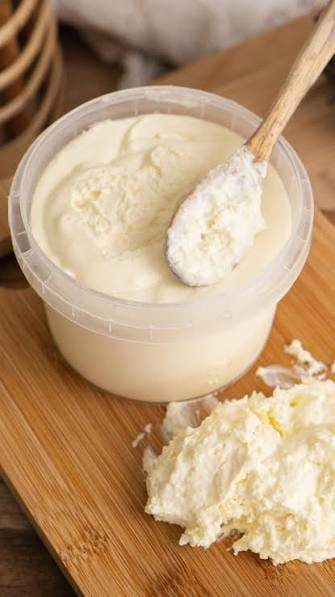

Dos natas con el mismo porcentaje pueden ser ingredientes muy distintos. Para hacer galletas, el dato que más pesa es la **materia grasa**, pero la etiqueta dice mucho más. Esto es lo que conviene mirar.

## 1. La materia grasa

Es el porcentaje de grasa por peso: una nata al 35 % tiene unos 35 g de grasa por cada 100 g. No mide pureza ni calidad. Según la norma española:

- **Nata ligera:** del 12 % a menos del 30 %.
- **Nata:** del 30 % a menos del 50 %.
- **Doble nata:** 50 % o más.

Para la galleta de nata tradicional, cuanto más alto, mejor: en las pruebas del proyecto, el punto llegó con nata de un 70-80 %. Tienes la explicación en [la guía sobre la nata de vaca](/autentica-nata-de-vaca/).

## 2. El tratamiento

El tratamiento no cambia la grasa, pero sí el ingrediente.

| En la etiqueta | Qué significa | Qué tener en cuenta |
| --- | --- | --- |
| Cruda | Sin tratamiento térmico | Conservar en frío y usar en elaboraciones que se cocinen |
| Pasteurizada | Calentada para eliminar microorganismos | Suele ir en refrigerado y durar menos |
| UHT | Calentada a temperatura muy alta, unos segundos | Aguanta sin frío hasta abrirla; luego, en frío |
| Homogeneizada | Glóbulos de grasa partidos y repartidos | No es un porcentaje de grasa, es un proceso |

## 3. Para qué está pensada

| En la etiqueta | Qué tener en cuenta para galletas |
| --- | --- |
| Para montar | Describe un uso; suele rondar el 35-40 % de grasa |
| Para cocinar | Menos grasa y estabilizantes; poco útil para esta galleta |
| Montada | Lleva aire y a menudo azúcar: no la sustituyas por el mismo volumen de nata líquida |
| Fermentada o agria | Es ácida y cambia la receta |
| En polvo | Una nata en polvo al 70 % no equivale a una nata líquida al 70 % |
| Sin lactosa | Es otra característica; no indica más o menos grasa |
| Preparado vegetal | No es nata láctea, aunque se parezca: otro ingrediente |

## 4. Los ingredientes añadidos

Muchas natas llevan estabilizantes, como el carragenano o la celulosa, para mejorar la textura o evitar que se corten. Si quieres una nata lo más parecida posible a la de leche, busca la lista de ingredientes más corta.

## 5. El origen y los sellos

«Gallega», «ecológica», «cruda» y «artesana» son cosas distintas. Una nata puede ser gallega y convencional, o ecológica y de otra zona. El origen lo dice la etiqueta, no el nombre de la marca. Sobre el sello ecológico, lee [galletas de nata ecológicas: qué garantiza el sello](/galletas-de-nata-ecologicas/).

## Resumen rápido

Antes de comprar nata para galletas, mira por este orden:

1. **Materia grasa:** cuanto más, mejor. Doble nata si la encuentras.
2. **Ingredientes:** cuantos menos, mejor.
3. **Tratamiento y conservación:** para saber cómo guardarla.
4. **Pesa en gramos**, nunca en mililitros, y apunta el envase exacto si vas a comparar.

## Un ejemplo para practicar

Imagina una etiqueta así. Es un ejemplo, no un producto concreto:

> **Nata para montar.** Materia grasa: 35 %. Ingredientes: nata, estabilizante (carragenano). UHT. Una vez abierto, conservar en frío y consumir en pocos días.

Así se lee:

- **35 % de materia grasa:** es «nata» según la norma. Sirve para la receta típica, pero dará una galleta más parecida a una de mantequilla.
- **Estabilizante:** lleva un ingrediente añadido. No es un problema, pero no es una nata sola.
- **UHT:** aguanta sin frío hasta abrirla. Después, a la nevera.
- **«Para montar»:** describe un uso, no la calidad.
