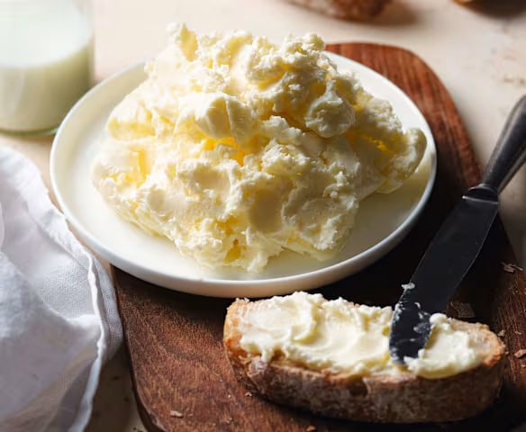

La diferencia está en la grasa. En una galleta de nata, **toda la grasa sale de la nata de vaca**. En una galleta de mantequilla, sale de la mantequilla. Muchas recetas mezclan las dos y las llaman «galletas de nata y mantequilla»: pueden estar muy ricas, pero no son la galleta de nata tradicional.

## Por qué tantas galletas de nata llevan mantequilla

Porque la nata que hace falta es difícil de conseguir. La galleta de nata de siempre necesita una nata con muchísima grasa, y la del supermercado suele rondar el 35 %. Con esa nata la masa no da el resultado, así que mucha gente la refuerza o la sustituye con mantequilla buena.

## Qué cambia en la galleta

En las pruebas del proyecto se horneó la misma galleta con natas de distinta grasa:

| Nata usada | Grasa aproximada en la galleta horneada | Cómo sabe |
| --- | --- | --- |
| 30-40 % de materia grasa | en torno al 20 % | Como una galleta de mantequilla |
| 70-80 % de materia grasa | en torno al 50 % | La galleta de nata de siempre |

Es decir: con una nata normal, la galleta acaba pareciéndose a una de mantequilla aunque no lleve mantequilla. La diferencia de sabor y textura la marca la cantidad de grasa que aporta la nata.

## La nata no es mantequilla, aunque tenga mucha grasa

Podría parecer que una nata del 70 % es «casi mantequilla». No lo es. La mantequilla tiene al menos un 80 % de grasa láctea, pero sobre todo tiene **otra estructura**: se obtiene batiendo la nata hasta que se separan los granos de grasa del suero, y queda una masa de grasa con gotitas de agua dentro. En la nata es al revés: gotitas de grasa repartidas en un líquido.

Por eso:

- Una nata al 70 % sigue siendo nata.
- Una nata al 35 % no es mantequilla, aunque con ella se pueda fabricar.
- Nata concentrada y mantequilla no se sustituyen sin más en una receta: cambian la masa de forma distinta.

## Cómo reconocerlas en la tienda

La lista de ingredientes va ordenada de mayor a menor cantidad.

- **Galleta de nata tradicional:** la nata es la única grasa. Nada de mantequilla, margarina ni aceites.
- **Galleta de nata y mantequilla:** aparecen las dos. Es una variante moderna.
- **Galleta de mantequilla con sabor a nata:** la mantequilla va antes que la nata, o la nata aparece al final de la lista.

## Cuál elegir

- Si buscas **la galleta de las abuelas gallegas**, busca solo nata, y cuanto más grasa, mejor.
- Si haces galletas en casa con nata del supermercado, ten en cuenta que saldrán más parecidas a unas de mantequilla.
- Si te gustan las de mantequilla, perfecto: son otra galleta, igual de válida, pero no la misma.

Para entender por qué la grasa de la nata lo cambia todo, lee [la guía sobre la nata de vaca](/autentica-nata-de-vaca/) y los resultados de [las pruebas con distintas natas](/pruebas-nata-en-galletas/).

## Preguntas rápidas

- **¿Llevaban mantequilla las galletas de las abuelas?** No. Se hacían con la nata que se juntaba de la leche hervida, sin otra grasa.
- **¿Por qué es más fácil encontrar galletas de mantequilla?** Porque la mantequilla se consigue en cualquier sitio y se conserva bien, y una nata con mucha grasa es difícil de encontrar.
- **¿Se pueden mezclar nata y mantequilla?** Muchas recetas lo hacen y salen buenas galletas. Pero ya no es la galleta de nata tradicional.
- **¿Cuál aguanta mejor el café o la leche?** Depende del grosor y de la textura de cada galleta más que de la grasa. Pruébalas y quédate con la tuya.
