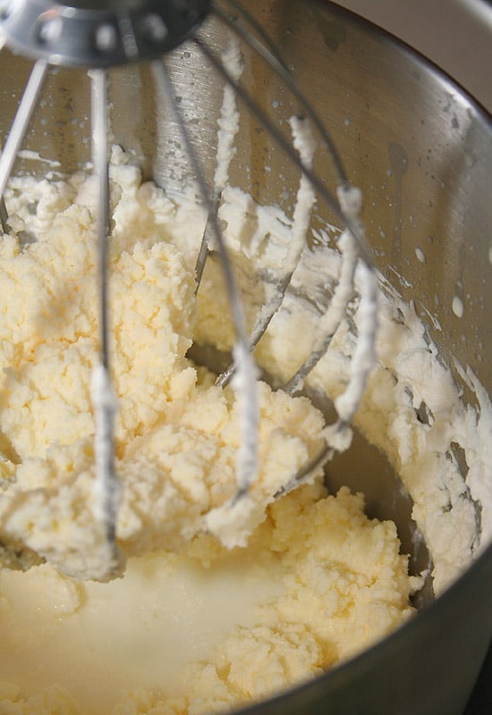
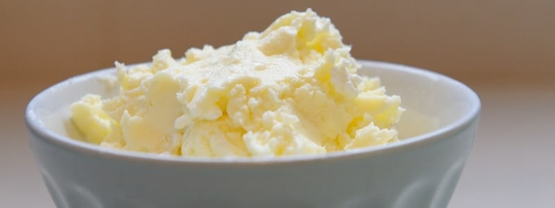

La diferencia principal es la grasa. La nata para montar ronda el 35-40 % de materia grasa, porque la necesita para atrapar aire. La nata para cocinar tiene bastante menos, en torno al 18 % en las fichas consultadas, y suele llevar estabilizantes para que no se corte al calentarla.

## Comparación

Datos de fichas de natas gallegas consultadas en octubre de 2026. Cada marca y cada formato pueden variar: mira siempre la etiqueta de la que compras.

| | Nata para montar | Nata para cocinar |
| --- | --- | --- |
| Materia grasa | 35-35,1 % en las fichas consultadas (35-40 % según la industria) | 18 % en la ficha consultada |
| Categoría legal | Nata (del 30 % a menos del 50 %) | Nata ligera (del 12 % a menos del 30 %) |
| Otros ingredientes habituales | Estabilizantes como el carragenano o la celulosa | Estabilizantes como la celulosa |
| Para qué sirve | Montar, postres, repostería | Salsas, cremas, guisos |

Dos detalles curiosos:

- **Dos formatos de la misma marca pueden llevar ingredientes distintos.** Si comparas natas, apunta el envase exacto, no solo la marca.
- **«Para montar» describe un uso, no una receta universal.** Que monte depende también de la temperatura y del proceso, no solo del porcentaje.

## Cuál usar para galletas de nata

Para la galleta de nata tradicional, **ninguna de las dos se acerca a lo que hace falta**. En las pruebas del proyecto, las natas del 30 al 40 % daban una galleta de en torno a un 20 % de grasa, con sabor a galleta de mantequilla. El punto llegó con nata de un 70-80 %.

Si tienes que elegir entre las dos, la de montar es mejor punto de partida porque tiene casi el doble de grasa. La de cocinar, con menos grasa y más agua, se aleja todavía más. Lo ideal es una doble nata o sacar tú la nata de leche cruda del día: tienes la explicación en [la guía sobre la nata de vaca](/autentica-nata-de-vaca/).
