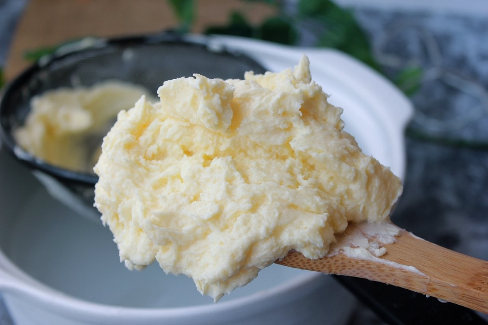

La forma más honesta de saber qué nata funciona es probarla. Desde 2012-2013, este proyecto ha probado muchos tipos de nata, ingredientes y procesos para recuperar la galleta de nata que se hacía en las casas gallegas. Esta es la parte de esas pruebas que tiene que ver con la nata.

La conclusión principal: **cuanta más grasa tiene la nata, mejor sale la galleta**. Las natas del 30 al 40 % no llegaron al resultado buscado; la nata de un 70-80 % de materia grasa, sí.

## Primera etapa: nata de leche cruda hervida

Las primeras pruebas siguieron el método de las abuelas: leche cruda del día, sin pasteurizar, hervida para recoger la nata de la superficie. La buena es la de la primera cocción; volviendo a hervir la leche se saca algo más. Hacían falta unos 10 litros de leche en 3 o 4 días para juntar nata suficiente para una hornada.

## Segunda etapa: natas comerciales y de lechera

Después se probaron natas de distinto contenido graso, compradas o servidas por lecheras, algunas ya desnatadas de fábrica.

| Nata | Materia grasa de la nata (% en masa) | Grasa aproximada en la galleta horneada | Resultado |
| --- | --- | --- | --- |
| Nata comercial o de lechera | 30-40 % | en torno al 20 % | Sabor a galleta de mantequilla; no llegaba al punto buscado |
| Nata de lechería con desnatadora especial (según su envase) | 70-80 % | en torno al 50 % | La galleta de nata tradicional |

La tabla recoge dos de los tres porcentajes que conviene no confundir: la grasa de la nata y la grasa de la galleta horneada. El tercero, cuánta nata lleva la masa, forma parte de la receta y no se publica aquí.

## Qué conclusiones se pueden sacar

- La cantidad de grasa de la nata es la variable que más cambia el resultado: la galleta pasa de tener en torno a un 20 % de grasa a tener en torno a un 50 %.
- Las natas habituales del supermercado, de entre el 30 y el 40 %, se quedan cortas para esta galleta.
- Una nata de un 70-80 % no es fácil de conseguir: hace falta una desnatadora especial o sacar la nata en casa a partir de leche cruda.

Estas conclusiones se limitan a las pruebas descritas. Otras recetas pueden buscar texturas distintas y funcionar con otras natas.

## Cómo hacer tu propia prueba en casa

Si quieres comparar natas, cambia solo una cosa cada vez. Si cambias dos a la vez, no sabrás cuál ha cambiado la galleta.

1. Usa la misma receta, la misma harina y el mismo azúcar en las dos tandas.
2. Pesa la nata en gramos. Apunta el envase exacto y su materia grasa.
3. Haz las galletas del mismo tamaño y grosor.
4. Hornéalas en el mismo horno, a la misma temperatura y durante el mismo tiempo.
5. Déjalas enfriar del todo antes de probarlas.
6. Pruébalas otra vez al día siguiente: la textura cambia al enfriarse y al reposar.

## Qué mirar al probarlas

- **Sabor:** ¿sabe a nata o a mantequilla?
- **Textura:** ¿se deshace en la boca, cruje o está dura?
- **Rotura:** ¿se parte limpia o se desmiga?
- **Color:** ¿el dorado es igual en el borde y en el centro?

Apuntarlo todo, aunque parezca poca cosa, es lo que permite repetir la que mejor sale.

## Si haces la prueba

Si comparas natas en tu cocina, cuéntalo en [Historias de casa](/historias-de-casa/): qué natas usaste, cómo salieron y cuál te gustó más.
