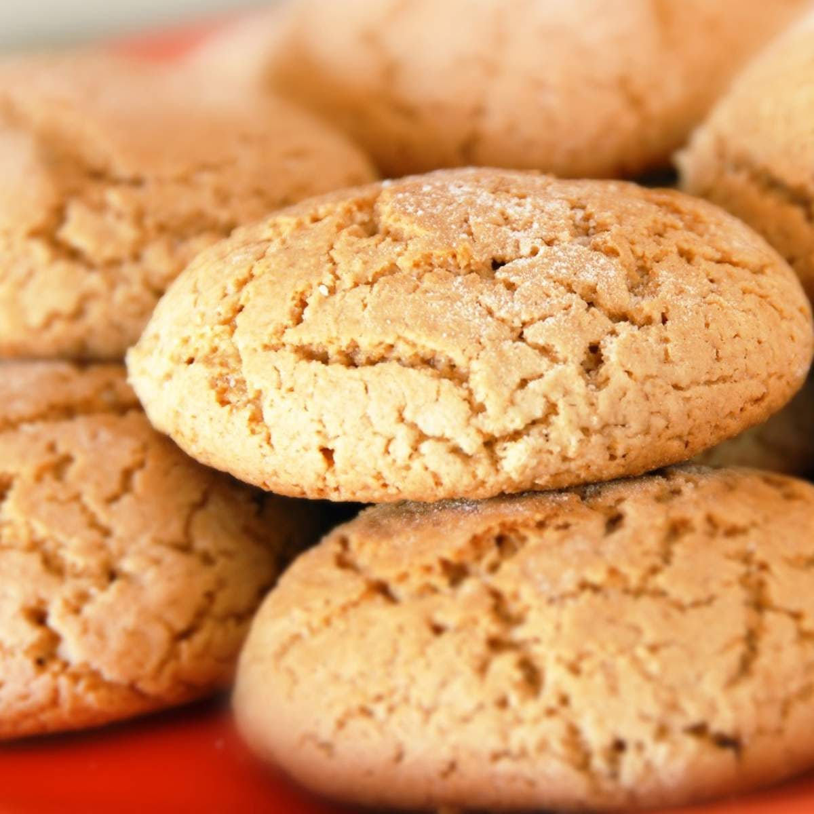
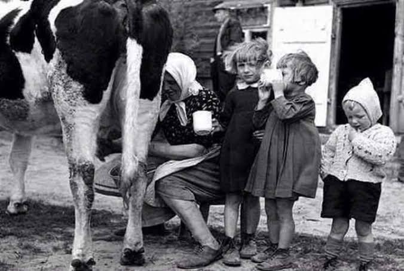
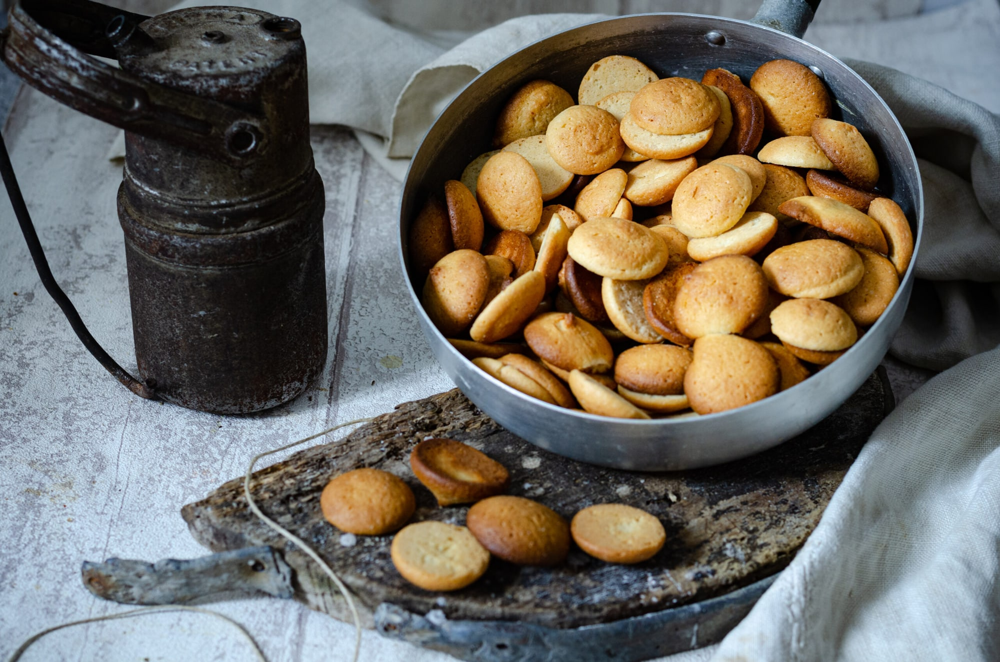

En muchas casas gallegas la leche no venía de la tienda: venía de la cuadra. Se ordeñaba, se hervía para que durase y, al enfriarse, dejaba arriba una capa de nata. Esa capa no se tiraba. Se apartaba, se guardaba y, cuando había bastante, se convertía en galletas para los niños.

Por eso la galleta de nata no tiene inventor ni fecha. Tiene casas. Cada familia la hacía a su manera, con la nata que juntaba y con su punto de horno.

## Cómo era una galleta de las de antes

Tres ingredientes: **nata, azúcar y harina**, a veces una pizca de sal. Toda la grasa salía de la nata. Ese es el rasgo que la distingue de una galleta de mantequilla: no hay otra grasa que la de la leche.

El resultado cambiaba de una cocina a otra. En unas casas salían más duras; en otras, más tiernas. Se medía a ojo o por vasos, y la harina era «la que admitiese» la masa.

## Tierra de vacas, tierra de galletas

Galicia es tierra de vacas y de leche: hoy produce en torno al 41 % de la leche de vaca de España. En una casa con vacas siempre había leche que hervir y nata que aprovechar. En casi toda la Galicia rural, y mucho en la comarca de Ferrol, las galletas de nata formaban parte de la infancia.

No son exclusivas de aquí. En otras zonas lecheras, y también en Portugal y Brasil, se hacen galletas parecidas con la nata de la leche hervida. Pero en Galicia se convirtieron en un dulce de casa muy reconocible.

## Por qué casi desaparecieron

En 1952 un decreto ordenó crear centrales lecheras en las ciudades. En las décadas siguientes, la leche tratada y envasada llegó a casi todos los hogares. Ya no hacía falta hervirla, y sin leche hervida no había capa de nata que guardar.

En los últimos años la galleta de nata ha vuelto: pequeños obradores gallegos la han recuperado con nata de mucha grasa y pocos ingredientes. Y en muchas cocinas se vuelve a hacer como antes.

