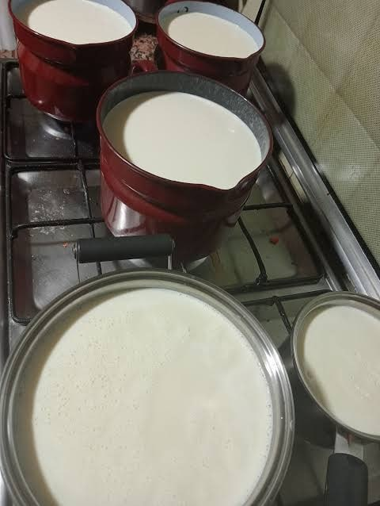
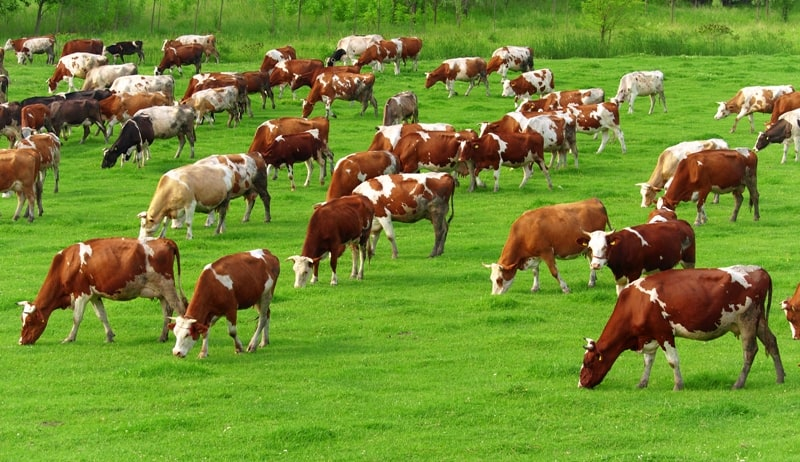
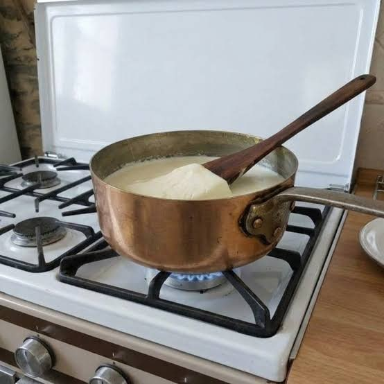

Durante generaciones, la nata de las casas gallegas no se compraba en brik. Salía de la leche del día. Se ordeñaba la vaca, la leche se ponía al fuego y, al enfriarse, en la superficie aparecía una capa espesa. Esa capa se retiraba con cuidado y se guardaba en el sitio más fresco de la casa.

## Granjas y vacas

Galicia es la primera comunidad productora de leche de vaca: en torno al 41 % de la leche de España. Aquí están más de la mitad de las explotaciones lecheras del país. Y la cabaña también ha cambiado: entre 1960 y 1975, las razas tradicionales gallegas pasaron de ser el 80 % de las vacas al 60 %, mientras la frisona subía del 6 % al 23 %.

## La nata de la leche hervida

Esa capa no es grasa pura. Al calentar la leche, parte de sus proteínas se agrupa en la superficie y atrapa glóbulos de grasa. Por eso la nata de casa era espesa. Se juntaba día a día, una semana o diez días, hasta tener suficiente para una hornada.

## De la desnatadora al brik

Hay otra forma de sacar la nata: centrifugando la leche con una desnatadora. Saca más grasa que la cocción y deja una nata más concentrada.

Con las centrales lecheras y la leche envasada, la nata de casa fue desapareciendo. Hoy la nata habitual es la de montar, en torno a un 35 % de materia grasa. La de la galleta de siempre tenía mucha más: en las pruebas del proyecto, el punto llegó con nata de un 70-80 % según el envase de la lechería que la desnataba.

## Por qué importa tanto

Una nata con más grasa lleva menos agua. En la galleta, eso cambia el sabor y la textura: con nata del 35 % la galleta se parece a una de mantequilla; con una nata mucho más grasa, se acerca a la galleta de nata de antes.

## Lo que dice la norma

En España, la nata se clasifica por su **materia grasa**, en porcentaje en masa:

| Nombre legal | Materia grasa |
| --- | --- |
| Nata ligera o delgada | del 12 % a menos del 30 % |
| Nata | del 30 % a menos del 50 % |
| Doble nata | 50 % o más |

**No hay ninguna categoría por encima.** Una nata del 70 % sigue siendo, legalmente, doble nata. Y la nata de montar del supermercado, en torno al 35 %, está en la categoría de «nata».

## Tres cifras que no hay que confundir

Cuando se habla de grasa y galletas, se mezclan tres números distintos:

1. **La grasa de la nata.** Lo que dice la etiqueta: 35 %, 50 %, 70 %.
2. **Cuánta nata lleva la masa.** La proporción de nata frente al azúcar y la harina.
3. **La grasa de la galleta ya horneada.** Lo que queda después del horno.

En las pruebas hechas para esta web, con natas del 30 al 40 % la galleta horneada quedaba en torno a un 20 % de grasa. Con nata del 70-80 %, en torno a un 50 %. Son cifras de la galleta, no de la nata, y no son un análisis de laboratorio.

## Qué nata comprar hoy

La nata de antes no se encuentra en el supermercado. Lo que sí se encuentra:

- **Doble nata**, si la hay: la mejor opción de tienda.
- **Nata para montar**, del 35 % o algo más: la que usa la receta típica.
- **Evita** la nata para cocinar, la ligera, la montada en spray y los preparados vegetales.

Elegir bien es leer la etiqueta por este orden: materia grasa, ingredientes y tratamiento. Lo explica paso a paso la guía [Qué nata comprar para hacer galletas de nata](/como-elegir-nata-para-galletas/).

## Si quieres acercarte a la nata de antes

La alternativa es sacarla en casa. Compra leche cruda del día, que la hay a la venta, y sácale la nata: hirviéndola, como las abuelas, o con una desnatadora, que saca más grasa. La nata buena es la de la primera cocción; una segunda da algo más, pero poca.

> **Seguridad.** La leche cruda puede contener microorganismos que causan enfermedades: guárdala siempre en frío, no la consumas sin tratar y úsala en elaboraciones cocinadas.

## Para seguir leyendo

- [Nata de vaca: tipos, materia grasa y cuál usar](/autentica-nata-de-vaca/), la guía completa.
- [Glosario de la nata](/glosario-de-la-nata/), palabra por palabra.
- [Cómo leer la etiqueta de una nata](/como-leer-la-etiqueta-de-una-nata/).
- [Pruebas con distintas natas](/pruebas-nata-en-galletas/), con sus resultados.
