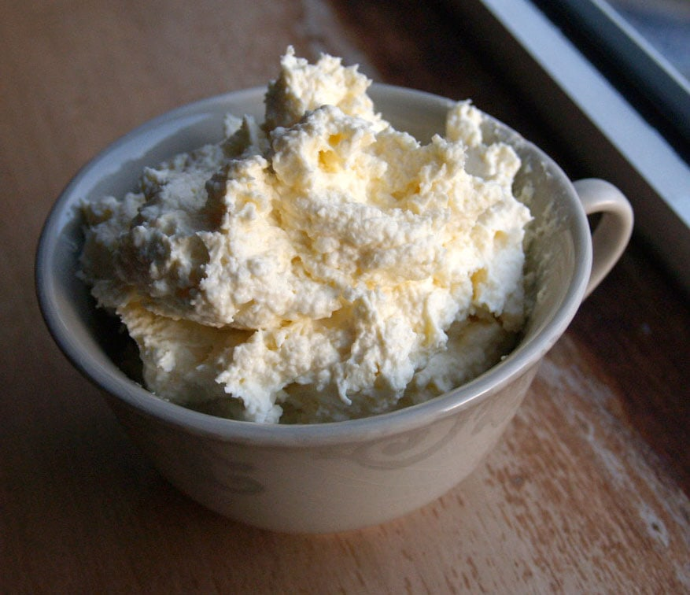

Durante generaciones, la nata de las casas gallegas no se compraba en brik. Salía de la leche del día. Se ordeñaba la vaca, la leche se ponía al fuego y, al enfriarse, en la superficie aparecía una capa espesa. Esa capa se retiraba con cuidado y se guardaba en el sitio más fresco de la casa.

## Granjas y vacas

Galicia es la primera comunidad productora de leche de vaca: en torno al 41 % de la leche de España. Aquí están más de la mitad de las explotaciones lecheras del país. Y la cabaña también ha cambiado: entre 1960 y 1975, las razas tradicionales gallegas pasaron de ser el 80 % de las vacas al 60 %, mientras la frisona subía del 6 % al 23 %.

## La nata de la leche hervida

Esa capa no es grasa pura. Al calentar la leche, parte de sus proteínas se agrupa en la superficie y atrapa glóbulos de grasa. Por eso la nata de casa era espesa. Se juntaba día a día, una semana o diez días, hasta tener suficiente para una hornada.

## De la desnatadora al brik

Hay otra forma de sacar la nata: centrifugando la leche con una desnatadora. Saca más grasa que la cocción y deja una nata más concentrada.

Con las centrales lecheras y la leche envasada, la nata de casa fue desapareciendo. Hoy la nata habitual es la de montar, en torno a un 35 % de materia grasa. La de la galleta de siempre tenía mucha más: en las pruebas del proyecto, el punto llegó con nata de un 70-80 % según el envase de la lechería que la desnataba.

## Por qué importa tanto

Una nata con más grasa lleva menos agua. En la galleta, eso cambia el sabor y la textura: con nata del 35 % la galleta se parece a una de mantequilla; con una nata mucho más grasa, se acerca a la galleta de nata de antes.
