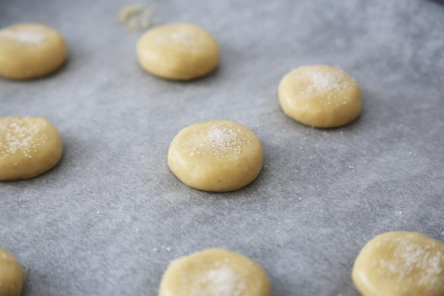

Las recetas de galletas de nata casi nunca estaban escritas. Se aprendían mirando: cuánta nata había juntado la semana, cuánto azúcar pedía, cuándo la masa dejaba de pegarse a las manos. Se medía por vasos y el resto lo decían las manos.

Por eso hay tantas versiones como casas. Y ninguna es falsa: cada una es la de su familia.

## Lo que no cambia

La base es siempre la misma: **nata, azúcar y harina**, con una pizca de sal. La masa se amasa lo justo, se enfría, se reparte en porciones y va al horno hasta que los bordes empiezan a dorarse.

## Lo que sí cambia

Con el tiempo aparecieron otras familias de recetas: con yema, con huevo y levadura, finas y recortadas o sin lactosa. Cada una da una galleta distinta. La tradicional sigue siendo la más sencilla, y en ella **la nata lo decide todo**: cuanta más grasa tiene, más se acerca a la galleta de siempre.

## Por qué en gramos

Un vaso no mide lo mismo en todas las cocinas. Pasar la receta a gramos permite que salga igual cada vez y que puedas comparar: si cambias la nata, sabrás que lo que ha cambiado es la nata.

Las recetas de esta sección se publican cuando se han probado enteras en un horno doméstico, con cantidades, tiempos y rendimiento reales.
